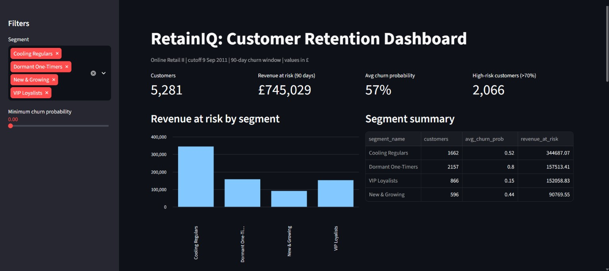
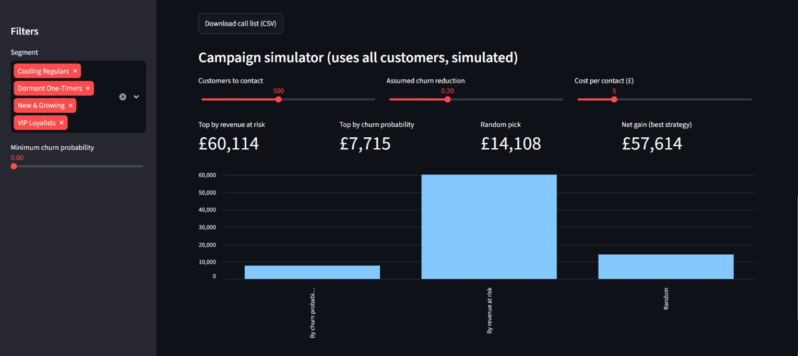

# RetainIQ: Customer Segmentation and Retention Analysis

**From customer segments to retention actions.** An end-to-end data science project on 779K retail transactions that answers one business question: *which customers should we contact first to protect the most revenue?*

**Tools:** Python, SQL (SQLite), pandas, scikit-learn, XGBoost, SHAP, matplotlib

---

## Key findings

- **16% of customers bring 67% of revenue.** The business depends on a small VIP group.
- **A leakage-safe churn model reaches 0.81 ROC-AUC** (XGBoost). A simple Logistic Regression scores 0.80, so recency, frequency, and spend do most of the work.
- **£745K of revenue is at risk over the next 90 days**, and the top 20% of customers hold 56% of it.
- **Picking the likeliest churners is a poor strategy.** In the campaign simulation, contacting the 500 customers most likely to churn saved *less than random outreach*, because they are mostly small one-time buyers. Ranking by *churn probability × expected value* saved about 4x more than random.

---

## Dataset

[Online Retail II](https://archive.ics.uci.edu/dataset/502/online+retail+ii) (UCI Machine Learning Repository), transactions of a UK online retailer.

| | |
|---|---|
| Raw rows | 1,067,371 |
| Clean rows | 779,425 |
| Customers (after cleaning) | 5,878 |
| Period | 1 Dec 2009 to 9 Dec 2011 |

**Cleaning:** removed rows without a customer ID (about 23%), cancelled invoices, zero or negative quantity and price, and duplicates.

---

## Approach

1. **Features in SQL.** Loaded the data into SQLite and built customer-level features: recency, frequency, monetary value, average order value, tenure, and product variety.
2. **Churn definition without leakage.** Cutoff date of **9 Sep 2011**. Features use only data before the cutoff. A customer is `churn = 1` if they made **no purchase in the next 90 days**. Churn rate: 56.6%.
3. **Segmentation.** Rule-based RFM scores as a baseline, then K-Means on log-transformed, scaled R/F/M. k = 4 was chosen using the elbow and silhouette plots.
4. **Churn models.** Logistic Regression (baseline), Random Forest, and XGBoost, with stratified 5-fold cross-validation and a held-out test set.
5. **Explainability.** SHAP values to show what drives each prediction.
6. **Business layer.** Out-of-fold churn probability × expected 90-day value = **revenue at risk**, which gives a ranked customer call list and a campaign simulation.

---

## Results

## Interactive dashboard

Explore the segments, filter by churn risk, download a call list, and simulate a retention campaign.

**[Live demo](https://retainiq-churn-dashboard.streamlit.app/)**




Run locally:

    pip install streamlit
    streamlit run app/app.py

### Segments (K-Means, k = 4)


| Segment | Customers | Avg recency (days) | Avg orders | Avg spend | Churn rate | Share of revenue |
|---|---|---|---|---|---|---|
| VIP Loyalists | 866 | 28 | 19.7 | £10,836 | ~20% | 67.4% |
| Cooling Regulars | 1,662 | 189 | 5.2 | £2,030 | ~50% | 24.2% |
| New & Growing | 596 | 27 | 2.6 | £718 | ~40% | 3.1% |
| Dormant One-Timers | 2,157 | 339 | 1.4 | £345 | ~80% | 5.3% |

The clustering never saw the churn column, yet churn rises cleanly from 20% to 80% across the segments.

### Churn models

| Model | CV ROC-AUC | Test ROC-AUC |
|---|---|---|
| Logistic Regression | 0.788 | 0.801 |
| Random Forest | 0.793 | 0.806 |
| **XGBoost** | 0.793 | **0.809** |

At a 0.5 threshold, XGBoost reaches 75% accuracy, with churn **precision 0.75** and **recall 0.84**.

### What drives churn (SHAP)


Time since last purchase is the strongest driver. High spend, frequent ordering, and a wide product range protect against churn.

### Revenue at risk

| Segment | Customers | Avg churn probability | Share of at-risk revenue | At risk per customer |
|---|---|---|---|---|
| Cooling Regulars | 1,662 | 0.52 | 46.3% | ~£207 |
| Dormant One-Timers | 2,157 | 0.80 | 21.1% | ~£73 |
| VIP Loyalists | 866 | 0.15 | 20.4% | ~£176 |
| New & Growing | 596 | 0.44 | 12.2% | ~£152 |

**Suggested actions:** personal outreach for VIP Loyalists, win-back offers for Cooling Regulars, and low-cost automated email for Dormant One-Timers.

### Campaign simulation (contact 500 customers)


Revenue saved over 90 days, **under assumed offer effects** (see limitations):

| Assumed churn reduction | Random 500 | Top 500 by churn probability | Top 500 by revenue at risk |
|---|---|---|---|
| 10% | £7,041 | £3,857 | **£30,057** |
| 20% | £14,043 | £7,713 | **£60,114** |
| 30% | £21,383 | £11,570 | **£90,171** |

---

## Limitations

- **The campaign results are a simulation.** The offer effect (10-30%) and the £5 contact cost are assumptions, not measured values. Real uplift needs an A/B test with a control group, since some customers would stay anyway and some may react badly to an offer.
- **Expected value is a run-rate estimate** (historical spend per 90 days), not a full Customer Lifetime Value model such as BG/NBD.
- **One cutoff date.** Sep to Dec is this retailer's peak season, so results may differ in other periods. Testing a second cutoff would check robustness.
- **A few very large accounts** dominate the top of the priority list and should be reviewed by hand.
- **The segments touch each other.** Customer behaviour is a continuum, so cluster boundaries are a useful simplification, not hard walls.

---

## How to run

```bash
git clone https://github.com/ANJALI198114/retainiq.git
cd retainiq
python -m venv venv
venv\Scripts\activate        # on Mac/Linux: source venv/bin/activate
pip install -r requirements.txt
```

1. Download `online_retail_II.csv` from the [UCI](https://archive.ics.uci.edu/dataset/502/online+retail+ii) or Kaggle page and place it in the `data/` folder.
2. Open `01_retainiq_analysis.ipynb` and run all cells.

**Outputs:** `data/features_segments.csv` (customer features and segments) and `data/priority_customers.csv` (top 50 customers to contact).
